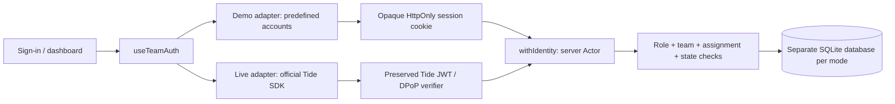

# Session 2 — TideCloak placement and temporary simulation

Updated 2026-10-22 for the explicit request: plan with Tide MCP, simulate sign-in, roles and access checks for now. No video, realm creation or licence registration is part of this update.

## MCP evidence and design decisions

Connected to the official Streamable HTTP MCP endpoint `https://mcp.tide.org/mcp` using JSON-RPC initialization and tool calls. The server identified itself as `@tideorg/mcp` version **1.9.33**. Read-only calls:

1. `tide_choose_playbook`: supplied the existing Next.js TeamVault workflow and the explicit temporary-simulation scope. It recommended API verification and RBAC playbooks for the future live integration.
2. `tide_playbook` with `name=protect-api-nextjs`: identity verification must happen at protected API boundaries; verify signature/issuer/client/time claims using embedded adapter keys. UI gating alone is insufficient.
3. `tide_playbook` with `name=add-rbac-nextjs`: distinguish realm and application client roles, enforce roles on the server, and keep encryption roles separate from business roles.

The playbooks describe live Tide prerequisites. This user-authorized simulator deliberately does not claim to fulfill those prerequisites: no fabricated adapter, Tide JWT, DPoP proof or successful enrollment. Demo session cookies are an independent local identity mechanism, clearly labelled throughout the UI and README.

## Placement

The operator chooses one mode. There is no client-controlled mode flag and no automatic fallback. Both paths produce `Actor { sub, name, roles }` at `withIdentity`. The API dispatcher and Store do not need to know how authentication occurred.

## Role policy

| Operation | Member | Reviewer | Admin |
|---|---|---|---|
| List/read projects | Own team | Assigned, not draft | All |
| Create/edit | Own team, editable state only | No | No implicit member privilege |
| Submit | Own team, draft/changes requested | No | No implicit member privilege |
| Review | No | Assigned, submitted, not own team | No implicit reviewer privilege |
| Teams/membership/assignment | No | No | Yes |

Project membership, assignments, workflow state and audit entries belong to the app database. In live mode, Tide provides the verified identity and roles. In demo mode, the server's fixed catalogue provides them; browser request payloads cannot invent extra roles.

## Implemented sequence

1. Preserve the live verifier/provider/callback path. Add explicit demo mode and a shared identity seam.
2. Create four sample identities, two teams and four illustrative projects in a separate persistent demo database.
3. Add demo sign-in/session/logout and server enforcement: 401/403/404, expiry, revocation and Origin checks for cookie mutations.
4. Connect the existing dashboard, forms, review decisions, admin management and timeline to the shared context.
5. Label simulated identity in the landing page and workspace. Exercise the actual API and UI, typecheck, tests and build.

## Switching to real Tide later

1. Resolve the existing realm licence issue with Tide/BTC, complete operator enrollment and export a valid public adapter. Do not reinitialize or delete the existing realm to hide an error.
2. Read the current MCP Next.js verification/callback/DPoP guidance again. The preserved real path is historical code, not proof of interoperability with the latest SDK/server.
3. Set `TEAMVAULT_AUTH_MODE=tide`, use the live database path and the official SDK. Demo session routes must return 404 and demo cookies must not authenticate API calls.
4. Assign real Tide roles and map real subject IDs to teams. Never copy `demo-*` identities into the live user mapping.
5. Test real login/logout, issuer/client/expiry/signature rejection, sender-constrained token handling, access isolation and the full review lifecycle. Only after successful verification describe the app as TideCloak protected.

References: [Tide MCP / Raziel](https://docs.tide.org/ai-agent-pack), [Tide token verifier](https://docs.tide.org/Languages/NextJS/VerifyJWT).
